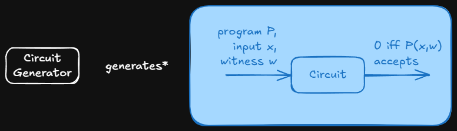
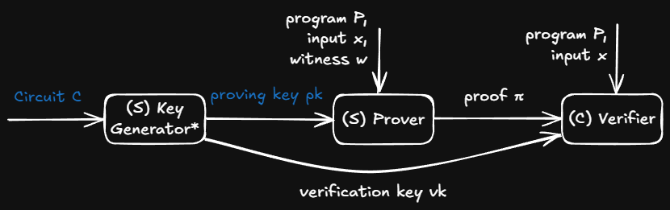

# Succinct Non-Interactive Zero Knowledge for a von Neumann Architecture

## Scenario

- Client (C) owns public input $x$
- Server (S) owns private input $w$ (witness)
- S computes $z=F(x,w)$ for C
- S would like to convince C that S computed $z$ correctly

## Conditions on a zk-SNARK proof

- zero-knowledge: Prevent C from learning $w$
- Succinct: $\pi$ has size $O_\lambda(1)$ for a fixed-size security parameter $\lambda$
- Non-interactive: S sends output $z$ and proof $\pi$, no further communication
- ARgument: Convince C that S calculated $z$ correctly
- of Knowledge: ... and that S knows solution

## Universal Circuit Generator

- Universal: Circuit Generator only takes runtime bounds as input, not program
- Circuit: Mathematically emulates CPU for given program+input+witness with arithmetic circuit

### inputs
- input bounds: $l$,$n$,$T$
- $l$ := instructions
- $n$ := input size
- $T$ := calculation steps

### Construction

- validate the instruction fetches
- validate instruction execution
- validate data loads/stores
- execution trace $tr = (S_1,I_1,\ldots,S_T,I_T)$
    - $S_i :=$ i-th CPU-State (contains pc, registers, flags at given time Stamp i)
    - $I_i :=$ i-th executed instruction

#### 1. Verify inital load of Program $P$ given as input to $C$

- extend execution trace $tr$ wit initial boot section where $P$ is loaded into memory for instruction per instruction

#### 2. Verify validity of instruction fetches and memory accesses

- $tr = (A_1,\ldots,A_{2T})$
- sorted list of all memory accesses (since instruction fetches is a special form of memory access)
- design $C$ to verify $tr* = MemSort(tr)$ is a correct permutation of $tr$
    - $Memsort(tr)$ is a sorting of $tr$ by accessed memory addresses
- create circuit $C'_{mem}$ to ensure the load-after-load and load-after-store consistency

#### 3. Verify validity of instruction execution

- Construct circuit $C_{exe}$ such
- given two CPU States $S,S'$ and instruction $I$
- $C_{exe}(S,S',I,g)$ is only satisfied for a non-deterministic guess g iff $S'$ can be reached from $S$ by executing $I$

## zk-SNARK protocol

- Consists of Key Generator, Prover, Verifier
- This paper: more efficient implementations of each component

### Key Generator

- Only takes circuit as input
- Since circuit doesn't depend on program, the key generator also only needs to be run once for runtime bounds
- Generates proving key $pk$ and verification key $vk$ using randomly sampled values $\alpha$
- $pk$ still "contains" the circuit
- BOTH keys can be public and reused

### Prover

- Takes proving key $pk$ (which contains the circuit), program $P$, input $x$ and witness $w$
- Hashes sensitive data (particularly the private witness $w$) using $\alpha$ (-> guarantees confidentiality)
- Outputs proof $\pi$

### Verifier

- Takes proof $\pi$, program $P$, input $x$, and verification key $vk$
- Checks that $vk$ matches $P$, given the proof $\pi$

## Limitations

- Efficiency: While this implementation is more efficient than previous state-of-the-art, it can only handle relatively small programs (up to 10,000 instructions on a desktop computer)
- Architecture: vnTinyRAM is comparably basic and doesn't support floating-point arithmetic, cryptographic acceleration, code libraries, tighter compilers
